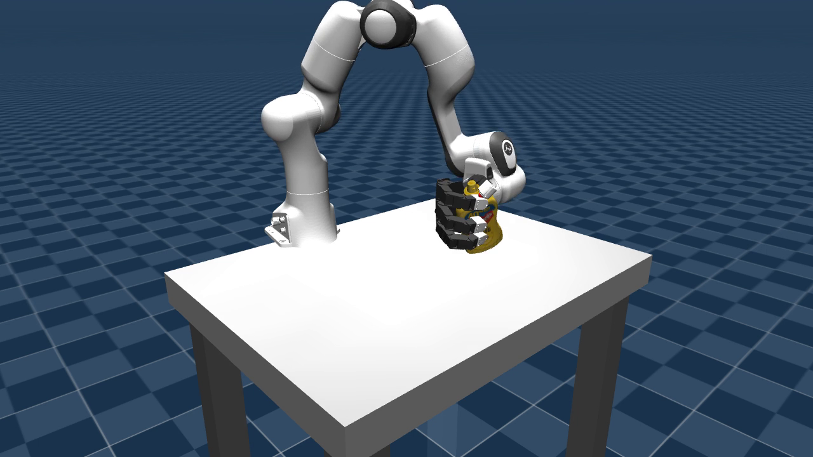
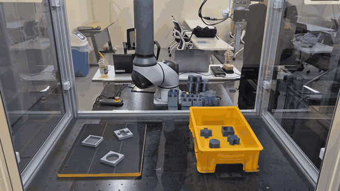

<h1 align="center">Minchan Jin · 진민찬</h1>

Robot Learning · Dexterous Manipulation · Vision-Language-Action

  I work on robot learning for dexterous manipulation. 
  My interests span vision-language-action models, reinforcement learning, 
  and tactile sensing for robotic hands.

  

A glimpse into my work — arm–hand manipulation in MuJoCo simulation.

## RGB-D Guided Robotic Manipulation

Developed an end-to-end robotic manipulation system integrating YOLO-based object segmentation, RGB-D perception, task planning, motion planning, and real-robot execution.

  

Real-robot pick-and-place demonstration · 1.5× playback speed.

## Research Interests

- **Dexterous manipulation** — coordinated arm–hand control and in-hand manipulation.
- **Robot learning** — VLA models, imitation learning, and reinforcement learning.
- **Tactile sensing** — contact-aware manipulation with multi-finger sensing.

## Tools I Work With

  
  
  
  
  
  

